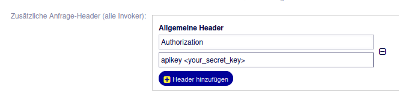

.. toctree::
    :maxdepth: 2
    :caption: Contents

Sacrifice to Sphinx
===================
Amen.

Description
===========
The OTOBO AI package is the OTOBO extension to interface with Large Language Model (LLM) for Retrieval-Augmented Generation (RAG).

System requirements
===================

Framework
---------
OTOBO 11.0.x

Packages
--------
\-

Third-party software
--------------------
\-

Usage
=====
This package adds support for storing Ticket, FAQ, and Document data in a Vector DB and using an LLM to generate Response Proposal via RAG.

The whole OTOBO AI Solution consists of 3 Components:

- The OTBO AI Extension package (this module)
- The OTOBO AI Services docker container providing the Vector DB
- A LLM for the actual RAG generation

Setup
-----
In order to make use of this package you need to run the OTOBO AI Services docker container first. Please resort to the documentation if OTOBO AI Services for more details, but as a quick guide:

Otobo-ai-services
-----------------

- Get the OTOBO AI services container from https://github.com/RotherOSS/otobo-ai-services/
- create a rags folder in the root directory
- copy the rag_examples/tfd_rag1 folder into the rags folder
- copy the `.env_example` file to `.env`
- edit the `.env` file and set the OTOBO_AI_API_KEY to something of your liking
- start up container with `docker compose up -d`

Test LLM connectivity
---------------------

Run this from the host where the otobo-ai-services container runs, and optionally also inside the container.

::

    curl -v http://ai.local.rother-oss.com:11434/api/generate -d '{ "model": "llama3.3:70b", "prompt": "Tell me about Shakespeare." }'

You should see a stream of text chunks coming back from the LLM

Test otobo-ai-services web service
----------------------------------

::
   
   curl -v 'http://otobo-ai:8000/otobo-ai/tfd_rag1/invoke' -H'Authorization: apikey <OTOBO_AI_API_KEY>' 
   -H 'Content-Type: application/json' -d '{ "input" : { "question": "Tell me about Shakespeare", "do_scoring" : true }, "config" : {}, "kwargs" : {} }'

You should see `Weiterleiten an Kundenservice` returned as result, which is the default answer if no context available for thequestion.

Otobo-ai extension package
--------------------------

- Install this package as usual via OTOBO Package Manager in the Admin UI.
- Verify the AI Webservice invokers have been installed properly at - go to Admin UI -> Webservices -> Edit Web Service: OTOBO-AI
- Add authentication by going to ‘Otobo as Requester’ -> Configure. Here, add a ‘Common Header’ at the bottom of the page. Set `Header Name` to 'Authorization'. Set `Header Value` to 'apikey <OTOBO_AI_API_KEY>'

Example Screenshot:

**Note:** The value for the Header is literally the string “apikey”, followed by a whitespace, followed by your custom API key.

Review and modify the Ingestion Parameters for Tickets, FAQ and Docs in the System Configuration under `Core::OTOBOAI`. At minimum configure these two settings:

- ``OTOBOAI::Ticket::SearchRestrictions`` - Hash of `TicketSearch <https://github.com/RotherOSS/otobo/blob/rel-11_0/Kernel/System/Ticket/TicketSearch.pm#L46>`_ Parameters.
     Sysconfig can be used for the most basic default Params. For more complicated setups create a 'OTOBOAI::Ticket::SearchRestrictions' Key in Config.pm and provide the TicketSearch Hash in Code
- ``OTOBOAI::FAQ::SearchRestrictions`` - Hash of `FAQSearch <https://github.com/RotherOSS/FAQ/blob/master/Kernel/System/FAQSearch.pm#L44>`_ Parameters.
     Sysconfig can be used for the most basic default Params. For more complicated setups create a 'OTOBOAI::FAQ::SearchRestrictions' Key in Config.pm and provide the FAQSearch Hash in Code
   
The package as well installs a ticket event module. This module triggers an asynchronous request to the LLM to provide content for a response template. Per default, the event is executed upon ArticleCreate, but the trigger is configurable via system configuration.
Check ``Ticket::EventModulePost###8000-PopulateOTOBOAIDynamicField``

Note that in case of an event which does not pass an article id, an attempt is made to retrieve the latest customer article of the ticket as base for the request.

Stripping Signatures
========================================

Enable the System Configuration setting ``OTOBOAI::StripSignatureRegex`` and set it to a Perl Regular Expression.
Otobo will try to strip everything from Ticket Article bodies starting from the first match of that regex.

Fine Tuning with Sample Score Evaluation
========================================

The Console Commands ``Maint::AI::Import`` and ``Maint::AI::Scoring`` can be used to do quality fine-tuning by using a sample set of tickets 
and evaluation the Quality score of the Sample. This allows to repeat samples runs to run multiple times, with different prompts. Quality Score
is a floating point number in the range from zero (0) to one (1).

To use Sampling/Scoring, you need to create a Ticket Sample subset first:

::

   bin/otobo.Console.pl Maint::AI::Import --reimport --sample /opt/otobo/sample.json

This will do a reimport of all sources (tickets, faqs, and docs) but will import only 90% of importable tickets into the AI vector-database
and retain the remaining 10% of Tickets for sampling. For the sample, a JSON encoded list of TicketIDs will be written to the json file specified by the 
sample parameter. This JSON file can then be fed multiple times into the ``Maint::AI::Scoring`` console command to evaluate the quality score.

One can re-use an existing sample.json file like so:

::

   bin/otobo.Console.pl Maint::AI::Import --reimport --reference /opt/otobo/sample.json

This will still do a re-import, but will hold back the exact same tickets for sampling. This is helpful for replicable test.

To run a sample score evaluation, run:

::

   bin/otobo.Console.pl Maint::AI::Scoring --limit 100 --sample sample.json --result scoring.csv --json scoring.json

This will read the first 100 TicketIDs from the sample.json file produced above, run each ticket through AI Answer generation and evaluate
the quality score of the resulting answer. Output will be written as a simple CSV (tab separated) file containing TicketIDs and the scores generated
by the evaluation prompt. The --json and --limit parameters are optional. Specifying a verbose JSON file with the --json switch will write
verbose output in JSON format to that file for manual inspection.

Console Commands
================

``Maint::AI::GetAnswer``

::

   bin/otobo.Console.pl Maint::AI::GetAnswer --help
   
   Retrieve an AI generated Answer from the otobo-ai-services container.
   
   Usage:
    otobo.Console.pl Maint::AI::GetAnswer [--article-id ...] [--ticket-id ...] [--question ...]
   
   Options:
    [--article-id ...]             - ArticleID
    [--ticket-id ...]              - TicketID
    [--question ...]               - Question
    [--help|h]                     - Display help for this command.
    [--no-ansi]                    - Do not perform ANSI terminal output coloring.
    [--quiet]                      - Suppress informative output, only retain error messages.

``Maint::AI::Import``

::

   bin/otobo.Console.pl Maint::AI::Import --help
   
   Import existing tickets and faq articles to the AI vector database.
   
   Usage:
    otobo.Console.pl Maint::AI::Import [--target ...] [--reimport] [--sample-nth ...] [--sample ...]
   
   Options:
    [--target ...]                 - Specify which objects will be migrated. t: Tickets; f: FAQ articles; d: documents. If not specified all sources will be handled.
    [--reimport]                   - Do a re-import, which means the AI vectorstore and fulltext postgres DBs will be purged.
    [--sample-nth ...]             - Only relevant with --do-scoring, specifies the sample size. Take every nth num for sampling. Specifying 10 will take every tenth, resulting in a 10% sample size. Specify 5 to take every 5th which will give 20% Sampelsize. Specify 20 to take every 20th which will yield 5% sample size. The default is 10.
    [--sample ...]                 - Specify a file path to write a sample.json file containing TicketIDs to sample. When specified, then severy sample-nth Ticket will not be imported, but added to the list of sample ids. The default for sample-nth is 10 to sample every 10th Ticket (10% sample size). Override with the --sample-nth parameter.
    [--reference ...]              - Specify a path to an existimg sample.json file and use that for holding back the sample
    [--help|h]                     - Display help for this command.
    [--no-ansi]                    - Do not perform ANSI terminal output coloring.
    [--quiet]                      - Suppress informative output, only retain error messages.

``Maint::AI::Scoring``

::

   bin/otobo.Console.pl Maint::AI::Scoring --help
   
   Do a quality evaluation and write the coring result into a file
   
   Usage:
    otobo.Console.pl Maint::AI::Scoring [--sample ...] [--result ...] [--verbose] [--limit ...]
   
   Options:
    [--sample ...]                 - Specify wfile path to sample.json file with the TicketIDs to sample. This file can be produced by the 'Maint::AI::Import' console command using the --sample option.
    [--result ...]                 - Specify the file path for the scoring output should be written to in CSV (tab separated) format.
    [--json]                       - when scoring, report verbosely for each ticket processed as JSON and write it to that file.
    [--limit ...]                  - when scoring, max number of ticket ids to take from sample.
    [--help|h]                     - Display help for this command.
    [--no-ansi]                    - Do not perform ANSI terminal output coloring.
    [--quiet]                      - Suppress informative output, only retain error messages.

Configuration Reference
-----------------------

Ticket::EventModulePost###8000-PopulateOTOBOAIDynamicField
""""""""""""""""""""""""""""""""""""""""""""""""""""""""""""""""""""""""""""""""""""""""""""""""""""""""""""""""""""""""""""""
Event module registration. For more performance you can define a trigger event (e. g. Event => TicketCreate). This is only possible if all Ticket dynamic fields need the same event.

Core::OTOBOAI
^^^^^^^^^^^^^^^^^^^^^^^^^^^^^^^^^^^^^^^^^^^^^^^^^^^^^^^^^^^^^^^^^^^^^^^^^^^^^^^^^^^^^^^^^^^^^^^^^^^^^^^^^^^^^^^^^^^^^^^^^^^^^^

OTOBOAI::AnswerTemplateRequestType
""""""""""""""""""""""""""""""""""""""""""""""""""""""""""""""""""""""""""""""""""""""""""""""""""""""""""""""""""""""""""""""
Define if fetching the AI answer on opening the Answer template should run synchronous or asynchronous.

OTOBOAI::Document::SearchRestrictions
""""""""""""""""""""""""""""""""""""""""""""""""""""""""""""""""""""""""""""""""""""""""""""""""""""""""""""""""""""""""""""""
Which documents to include for AI search ingestion.

OTOBOAI::DynamicFieldOTOBOAI
""""""""""""""""""""""""""""""""""""""""""""""""""""""""""""""""""""""""""""""""""""""""""""""""""""""""""""""""""""""""""""""
This option defines the dynamic field in which an OTOBOAI answer is stored.

OTOBOAI::FAQ::SearchRestrictions
""""""""""""""""""""""""""""""""""""""""""""""""""""""""""""""""""""""""""""""""""""""""""""""""""""""""""""""""""""""""""""""
Which FAQ articles to include for FAQ ingestion.

OTOBOAI::OverwritePreviousResponse
""""""""""""""""""""""""""""""""""""""""""""""""""""""""""""""""""""""""""""""""""""""""""""""""""""""""""""""""""""""""""""""
By activating this option, previous AI answers fetched for an article are ignored and a new request to the LLM is started.
Activating this setting currently makes only sense with `OTOBOAI::AnswerTemplateRequestType` set to
'synchronous'.

OTOBOAI::Placeholder
""""""""""""""""""""""""""""""""""""""""""""""""""""""""""""""""""""""""""""""""""""""""""""""""""""""""""""""""""""""""""""""
Define a string which is used as a placeholder while waiting for the AI answer.

OTOBOAI::Ticket::SearchRestrictions
""""""""""""""""""""""""""""""""""""""""""""""""""""""""""""""""""""""""""""""""""""""""""""""""""""""""""""""""""""""""""""""
Add search restrictions or params, to add not all tickets in the otobo ai vector database.

OTOBOAI::StripSignatureRegex
""""""""""""""""""""""""""""""""""""""""""""""""""""""""""""""""""""""""""""""""""""""""""""""""""""""""""""""""""""""""""""""
Regex to strip Signatures from Article Bodies, if endabled.

OTOBOAI::AllowedArticleSenderTypes
""""""""""""""""""""""""""""""""""""""""""""""""""""""""""""""""""""""""""""""""""""""""""""""""""""""""""""""""""""""""""""""
Valid SenderTypes for Article selection when indexing and importing into AI. Valid values are "agent", "customer", and 
"system". By default this contains only customer and agent.

OTOBOAI::OnlyVisibleForCustomer
""""""""""""""""""""""""""""""""""""""""""""""""""""""""""""""""""""""""""""""""""""""""""""""""""""""""""""""""""""""""""""""
Allow only Articles visible for Customer to be embedded for AI

Daemon::SchedulerCronTaskManager::Task
^^^^^^^^^^^^^^^^^^^^^^^^^^^^^^^^^^^^^^^^^^^^^^^^^^^^^^^^^^^^^^^^^^^^^^^^^^^^^^^^^^^^^^^^^^^^^^^^^^^^^^^^^^^^^^^^^^^^^^^^^^^^^^

Daemon::SchedulerCronTaskManager::Task###RebuildOtoboAIIndex
""""""""""""""""""""""""""""""""""""""""""""""""""""""""""""""""""""""""""""""""""""""""""""""""""""""""""""""""""""""""""""""
Rebuilds the Otobo AI Vector DB index.

Frontend::Admin::ModuleRegistration
^^^^^^^^^^^^^^^^^^^^^^^^^^^^^^^^^^^^^^^^^^^^^^^^^^^^^^^^^^^^^^^^^^^^^^^^^^^^^^^^^^^^^^^^^^^^^^^^^^^^^^^^^^^^^^^^^^^^^^^^^^^^^^

DashboardBackend###0160-OTOBOAIDashboard
""""""""""""""""""""""""""""""""""""""""""""""""""""""""""""""""""""""""""""""""""""""""""""""""""""""""""""""""""""""""""""""
Parameters for the dashboard backend of the tickets overview by search template of the agent interface. "Limit" is the number of entries shown by default. "Group" is used to restrict the access to the plugin (e. g. Group: admin;group1;group2;). "Default" determines if the plugin is enabled by default or if the user needs to enable it manually. "CacheTTLLocal" is the cache time in minutes for the plugin. "Mandatory" determines if the plugin is always shown and can not be removed by agents. Note: Only Ticket attributes and Dynamic Fields (DynamicField_NameX) are allowed for DefaultColumns.

OtoboAIDashboard::Frontend::CacheTTL
""""""""""""""""""""""""""""""""""""""""""""""""""""""""""""""""""""""""""""""""""""""""""""""""""""""""""""""""""""""""""""""
Number of hours of TTL for the Otobo-AI cache elements.

OtoboAIDashboard::Frontend::PollingInterval
""""""""""""""""""""""""""""""""""""""""""""""""""""""""""""""""""""""""""""""""""""""""""""""""""""""""""""""""""""""""""""""
Number of seconds on the client side between attempts to get a cached answer.

OtoboAIDashboard::Frontend::TextAreaQuestion
""""""""""""""""""""""""""""""""""""""""""""""""""""""""""""""""""""""""""""""""""""""""""""""""""""""""""""""""""""""""""""""
Permitted width for compose question windows.

OtoboAIDashboard::Frontend::TimeoutInterval
""""""""""""""""""""""""""""""""""""""""""""""""""""""""""""""""""""""""""""""""""""""""""""""""""""""""""""""""""""""""""""""
Timeout to consider that a request has no response.

About
=======

Contact
-------
| Rother OSS GmbH
| Email: hello@otobo.io
| Web: https://otobo.io

Version
-------
Author: |doc-vendor| / Version: |doc-version| / Date of release: |doc-datestamp|
